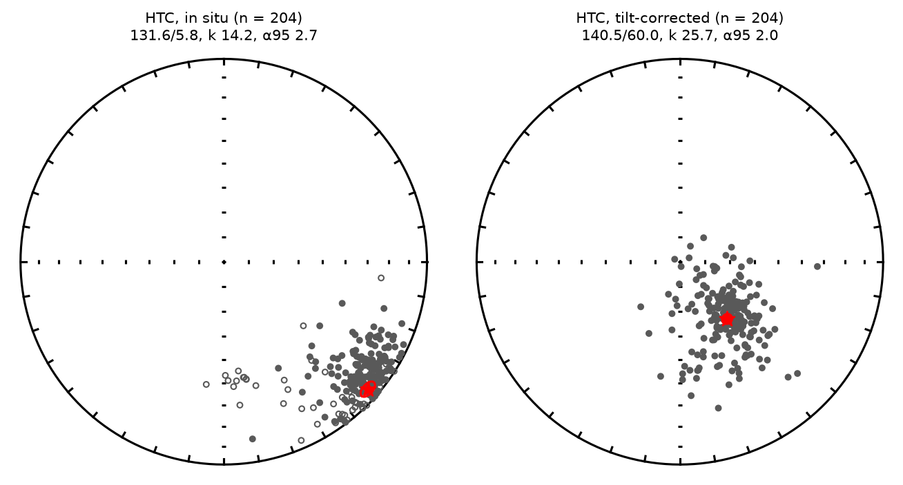

# Jiabula Formation, Zhangda section: build report

Written by `convert.py`; do not edit. Study: Yuan et al. (2025), doi:10.1016/j.jseaes.2024.106428; data doi:10.57760/sciencedb.15244. `README.md` explains the sources and the decisions.

## Contents of the contribution

| Table | Rows | Source |
| --- | --- | --- |
| specimens | 408: the high-temperature component of 204 specimens, in situ and tilt-corrected | table (Table S3) |
| samples | 204: one for each specimen | table (bedding); text (sampling, orientation) |
| sites | 408: one for each specimen, in situ and tilt-corrected | table (directions, bedding); text (position, age, lithology) |
| locations | 4: the section, and three published mean directions, one with the pole | text |
| ages | 1 | text |

## Validation with the rules of MagIC (`pmagpy.magic_validation`)

No problems.

## Uploading to MagIC

`magic_contribution.txt` holds every table except the contribution table, which is made on MagIC when the file is uploaded (the file is written with `ipmag.upload_magic`). Enter there:

- Reference: 10.1016/j.jseaes.2024.106428
- Laboratory: Paleomagnetism and Geochronology Lab Beijing (Chinese Academy of Sciences, China)
- Description: Built from Table S3 of the supplement, which the authors archived at Science Data Bank (https://doi.org/10.57760/sciencedb.15244), and from the paper. Sources, choices and checks are documented at <permalink>.

`<permalink>` is the link to this study folder at the commit the upload is made from, so that it keeps pointing to the files that made the contribution. After committing and pushing, `python common/studies.py --permalink yuan_2025_jiabula` prints it; enter that commit as `upload_commit` in `study.json`.

## Table S3

`table_s3.csv` has 204 rows, from 27 field sites (ZL01 to ZL27). Each printed tilt-corrected direction was recalculated from the printed in situ direction and bedding (dip direction = strike + 90°) with `pmag.dotilt`. 203 of 204 are reproduced within 0.15° with the printed bedding (largest difference 0.11°); with the bedding entered, 204 of 204.

- zl02-1: printed with strike 212.0, dip 46.0, which gives a direction 7.17° from the printed one. Strike 203, dip 49, the bedding of the other specimens of ZL02, gives it within 0.06° and is entered as inferred.

With the bedding entered, each field site has one bedding (true for all 27).

## Mean directions

Fisher means of the directions of Table S3 (`pmag.fisher_mean`) against the published means.

| result | N_pub | N | dec_pub | dec | inc_pub | inc | k_pub | k | a95_pub | a95 | angle | reproduced |
| --- | --- | --- | --- | --- | --- | --- | --- | --- | --- | --- | --- | --- |
| HTC, in situ (Fig. 6c) | 204 | 204 | 131.6 | 131.56 | 5.8 | 5.84 | 14.2 | 14.20 | 2.7 | 2.71 | 0.06 | yes |
| HTC, tilt-corrected (Fig. 6d) | 204 | 204 | 140.5 | 140.50 | 60.0 | 60.04 | 25.7 | 25.74 | 2.0 | 1.98 | 0.04 | yes |
| HTC, tilt-corrected, 45° cutoff (Fig. 7d) | 197 | 197 | 140.6 | 140.60 | 59.3 | 59.30 | 29.3 | 29.27 | 1.9 | 1.89 | 0.00 | yes |

The 45° cutoff of the authors' second elongation/inclination analysis is reproduced as a cutoff on the tilt-corrected VGPs about their Fisher mean. It leaves out 7 specimens: zl02-1, zl14-5-1, zl16-6, zl19-2, zl19-5, zl20-1, zl27-1.

## Pole

| calculation | lat | lon | A95 | dp | dm | from_published |
| --- | --- | --- | --- | --- | --- | --- |
| published | 11.20 | 300.50 | 2.60 |  |  | 0.00 |
| pole of the published mean direction | 11.20 | 300.45 | 2.63 | 2.29 | 3.02 | 0.05 |
| pole of the mean direction of Table S3 | 11.17 | 300.42 | 2.61 | 2.27 | 3.00 | 0.08 |
| Fisher mean of the specimen VGPs | 9.30 | 299.78 | 2.62 |  |  | 2.03 |

In the A95 column, the two poles of a mean direction have √(dp·dm). The published pole is the pole of the mean direction (`pmag.dia_vgp`), given as the pole in the northern hemisphere, and its A95 is √(dp·dm). Paleolatitude from the mean inclination of Table S3 (`pmag.plat`): 40.9° (published 40.9°S).

## Fold tests

- McElhinny (1964): k tilt-corrected / k in situ from Table S3 is 1.81 (published 1.81).
- Progressive unfolding: untilting the directions of Table S3 in steps of 1 percent of the dip, k rises from 14.2 to a maximum of 25.7 at 100 percent (published: maximum 25.6 at 100 percent).
- The McFadden (1990) statistics are entered as published and are not recalculated.

## Elongation/inclination

`ipmag.find_ei` on the tilt-corrected directions, with 1000 bootstrap pseudo-samples (seed 1). `elongation` is that of the directions and `expected` the elongation of the TK03 model at their inclination (`pmag.EI`). The method looks for the flattening factor at which the unflattened directions reach the model's elongation; `f` and `inc` are 0 where the function finds none for the data set (its "pathological distribution"). `solutions` is the number of pseudo-samples that have one, and the last three columns are the median and the 95 percent bounds of their corrected inclinations. `published` is the corrected inclination and its bounds in the paper. The bootstrap is random, so these inclinations change with the seed, and the authors' are from another run: with seeds 1, 2 and 3 the median for all directions was 62.7, 62.3 and 62.9°, the lower bound 59.6, 59.5 and 59.5° and the upper bound 68.6, 71.1 and 69.8°. The comparison is therefore loose: `comparable` says whether the median and both bounds are within 2.5° of the published values, where at least 50 pseudo-samples have a solution.

| directions | n | inclination | elongation | expected | f | inc | solutions | inc_median | inc_low | inc_high | published | comparable |
| --- | --- | --- | --- | --- | --- | --- | --- | --- | --- | --- | --- | --- |
| all | 204 | 60.1 | 1.72 | 1.43 | 0.00 | 0.0 | 94 | 62.7 | 59.6 | 68.6 | 63.0 (59.0 to 69.0) | within 2.5° |
| within the 45° cutoff | 197 | 59.4 | 1.90 | 1.44 | 0.00 | 0.0 | 4 | 60.7 | 60.1 | 61.4 | 61.0 (59.0 to 64.0) | too few solutions |

The directions are already more elongate than the model expects at their inclination, so the function finds no flattening factor for either set. The published values are entered in the description of the pole as printed, with this recalculation beside them.

## Information that would complete the contribution

- The demagnetization measurements, and the steps and line type of each fit.
- The directions of the low-temperature component (268 specimens).
- Which specimens come from the same core, and the core orientations.
- The coordinates of the 27 sites.
- Confirmation of the bedding of specimen zl02-1.

